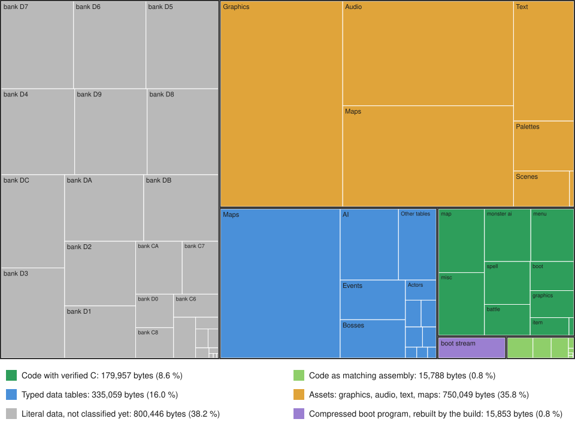

# som-decomp

A decompilation and reverse-engineering project for **Secret of Mana** (SNES, North America, v1.0): matching 65816 and SPC700 assembly for the whole ROM, readable C for the game's code, and plain-language documentation of its systems (combat formulas, monster AI, bosses, cutscenes, maps, menus, audio, boot).

  

> **This repository does not contain the game.** It holds no ROM, and the graphics, audio, text and map data are not stored here: `make setup` writes them from your own copy of the ROM. You must supply a ROM dumped from your own cartridge.

## Project status

| Area | Done | What it measures |
|---|---:|---|
| Code decompiled to readable C | **96.6 %** of code bytes (3,223 of 3,273 routines) | 206,039 of 213,249 bytes of catalogued code have C that passes a differential test against the original routine on captured game states, plus fuzzing and a mutation check (a deliberately broken copy must fail the test) |
| ROM as matching source | **99.2 %** | 2,081,299 of 2,097,152 ROM bytes live as assembly sources under `src/`; the remaining 15,853 bytes are the compressed boot program, which the build recompresses from its decoded sources |
| Byte-exact rebuild | **100 %** | after `make setup`, the sources assemble to all 2,097,152 bytes of the original (SHA-256 below) |
| Documentation | **72.9 %** | share of the ROM whose meaning is documented: 1,528,940 bytes including independently reviewed overlays (62.1 % without them) |

The map below is the whole ROM, one rectangle per kind of content, with area proportional to bytes (in the spirit of WinDirStat or QDirStat). Green is code, blue is data whose fields are typed, orange is assets of a known kind, grey is literal data nobody has classified yet.



| Kind of content | Bytes | Share of the ROM |
|---|---:|---:|
| Code with verified C | 179,957 | 8.6 % |
| Code as matching assembly only | 15,788 | 0.8 % |
| Typed data tables | 335,059 | 16.0 % |
| Assets: graphics, audio, text, maps | 750,049 | 35.8 % |
| Literal data, not classified yet | 800,446 | 38.2 % |
| Compressed boot program, rebuilt by the build | 15,853 | 0.8 % |

The code share of the map counts physical ROM bytes; the C figures above also include the boot program that the game decompresses into work RAM. Regenerate the map and the figures with `python3 tools/rom_progress_treemap.py`.

## And now, the GREAT question you all got

*What decides which moon you see on the last screen of the game?*

It is not your story progress, your party, your items or your play time. The last screen shows one of three moons (full, gibbous or crescent), and the game picks it with a three-sided die roll when the scene is built. The roll is not truly random: it is seeded with the checksums of your four save slots. So the same saves always give the same moon, and saving the game again (even in the same spot, without doing anything) usually changes it. With empty save RAM in an emulator you get the gibbous moon.

The plain-language explanation, with diagrams of the code path and the save RAM and pictures of the three moons, is in [ending-moon-explained.md](docs/ending-moon-explained.md). The original investigation and its emulator experiments are in [ending-moon-20261018.md](docs/ending-moon-20261018.md) (reproduce with `tools/ending_moon.py`).

## Getting started

### The ROM

| Release | Header title | CRC32 | SHA-1 | SHA-256 |
|---|---|---|---|---|
| North America, v1.0, 2 MiB HiROM ("Secret of Mana (U) [!]") | `Secret of MANA` | `D0176B24` | `8133041a363e3cc68cedef40b49b6d20d03c505d` | `4c15013131351e694e05f22e38bb1b3e4031dedac77ec75abecebe8520d82d5f` |

A 512-byte copier header is accepted and ignored. Other releases are not supported.

### Requirements

- Python 3 (standard library only)
- [cc65](https://cc65.github.io/) (`ca65` and `ld65`), for example `apt install cc65`
- For running the game or the emulator-based tools: RetroArch with the snes9x or bsnes core

### Build and verify

```
cp /path/to/your/rom.sfc baserom.sfc
make setup                 # writes the asset and literal-data sources from baserom.sfc
make verify-source         # assembles every source block and compares it with the ROM
make build-recovered-rom   # builds the image from src/ alone
make verify-recovered-rom  # checks that image against baserom.sfc byte for byte
```

`make verify-source` assembles about 154,000 blocks; pass `--jobs N` to `tools/verify_source.py` to run it in parallel. `python3 tools/som_run.py` builds the image and starts it in RetroArch.

## Repository layout

```
src/            matching assembly: rom/ (65816), boot/ (the decompressed boot program), spc/ (SPC700 sound driver)
src/manifest.json   every source block: address, size, kind, element type, documentation
tools/          Python tools: assembler driver, ROM extraction, 65816/SPC700 interpreters, models and validators
tools/decomp_c/src/ readable C, one file per routine, grouped by subsystem
data/           numeric tables and measurements (no graphics, audio or text), decomp status, region catalogue
docs/           documentation of the game's systems and of how each claim was checked
```

### Readable C

`tools/decomp_c/src/` holds one C file per original routine, grouped by subsystem (`battle`, `map`, `menu`, `monster_ai`, `spell`, `graphics`, `item`, `boot`, `audio`, `misc`). Each file names the routine's address, size, entry state and the registers its callers read. `data/decomp_c_status.json` records, for every routine, how it was verified: captured game states replayed against the original, fuzzing, synthetic states, instruction coverage and the mutation check. The runtime the C runs on is in `tools/decomp_c/rt/`. The capture-based verification harness is not published yet, because it depends on large captured state sets.

Every claim in the documentation is tagged. **[V]** means the routine was executed in the interpreter in `tools/` and a model was checked against it, or a value was cross-checked against live game objects. **[C]** means it was read from the disassembly, not executed. What is not known is listed under "Open questions" in each document.

## Special thanks

This project stands on the work of people who shared theirs:

- **Moppleton and contributors**, authors of the [Secret of Mana Randomizer](https://github.com/Moppu/SecretOfManaRandomizer) and of its **Ancient Cave** mode.
- **The authors of the Secret of Mana quality-of-life and bug-fix patches** listed on romhacking.net and elsewhere; each patch's author and source is credited in `docs/qol-patches-survey-20261020.md`.
- **The Secret of Mana reverse-engineering and documentation community** (disassemblies, data maps, tools and write-ups); the external sources used are listed in `docs/external-reverse-engineering-sources.md`.

## Contents

### `tools/`
Python 3, standard library only.
- `boot_startup.py`:36 continuous original cold/native/warm boot comparisons, including decoded memory, hardware register sequence and entry state.
- `rom_progress.py`: audited coverage of documented ROM fields/ranges, counting overlaps once and checking source values; writes `data/progress.json` and `data/rom_regions.json`.
- `boot_tasks.py`: boot resources, task creation, priority insertion, initial stacks, task completion and new/completed-task dispatch models checked against original RAM instructions.
- `boot_pool.py`, `boot_heap.py`, `boot_cleanup.py`, `boot_resume.py`, `boot_wait.py`, `boot_create.py`, `boot_receive.py`, `boot_ppu_queue.py`, `boot_input.py`, `boot_input_interfaces.py`, `boot_copy_queue.py`, `boot_dma.py`, `boot_vram.py`, `boot_palette.py`, `boot_graphics.py`, `boot_colour.py`, `boot_tiles.py`, `boot_colour_scene.py`, `boot_colour_protocol.py`, `boot_coefficients.py`, `boot_transform.py`, `boot_pixels.py`, `boot_image_protocol.py`, `boot_image.py`, `boot_image_task.py`, `boot_parent_messages.py`, `boot_parent_receive.py`, `boot_parent_dispatch.py`, `boot_parent_control.py`, `boot_parent_fade.py`, `boot_parent_transition.py`, `boot_title_sequence.py`, `boot_control_task.py`, `boot_title_window.py`, `boot_title_reveal.py`, `boot_title_scroll.py`, `boot_title_expand.py`, `boot_title_teardown.py`, `boot_buffer_cleanup.py`, `boot_buffer_rows.py`, `boot_buffer_setup.py`, `boot_buffer_animation.py`, `boot_interrupts.py`, `boot_trace.py`: checked boot record/heap operations and completed-task cleanup, native interrupt restoration probes, and a bounded reset/title trace to the main-game entry. See `docs/boot.md`.
- `map_piece_regions.py`, `map_asset_regions.py`, `script_regions.py`: address/size inventories from established readers, including conditional pieces, map assets and all 2,048 event boundaries; no graphics/text/script bytes saved.
- `dispatch_tables.py`: four resolved interpreter dispatch tables and entry M/X in `data/dispatch.json`; see `docs/dispatch.md`.
- `coverage_run.py`, `coverage_merge.py`: actual PC/M/X coverage around existing validators/harnesses, with ROM/tool/CPU hashes. See `docs/coverage.md`.
- `boot_decode.py`: the `$C1:4C30` compressed format, checked against the real routine for the boot program and four initialization blocks, the reset run to `$7E:AF0B`, and 240 generated cases; optional RAM disassembly without byte columns. See `docs/boot.md` and `data/boot.json`.
- `cpu65816.py`: a small 65816 interpreter used to run routines from the ROM.
- `disasm65.py`, `flowdis.py`, `aidis.py`, `hsum.py`, `statescript.py`: disassemblers and bytecode decoders (recursive-descent disassembly with M/X tracking, enemy AI bytecode lister, boss state-script decoder).
- `combat_env.py`, `zsnes_state.py`: harness that runs any ROM routine on top of the WRAM of a ZSNES v143 save state.
- `rng.py`, `phys_model.py`, `magic_model.py`, `hero_stats.py`, `weapon_level.py`: Python models of the game's random number generator, physical damage, spell damage, hero stat build and weapon level-up.
- `romio.py`: ROM loader shared by the tools (the ROM path is always the first command-line argument).
- `validate_phys.py`, `validate_magic.py`, `validate_magic_level.py`, `validate_exp.py`, `validate_drops.py`, `validate_status_rules.py`, `validate_boss_attacks.py`, `charge_timing.py`, `status_timing.py`: run the real routines with random inputs and compare them with the models.
- `dump_tables.py`, `dump_gap_tables.py`, `boss_records.py`: write the JSON tables in `data/`.
- `boss_sim.py`, `lich_dump.py`, `lich_sim.py`, `lich_events.py`, `lich_hit_test.py`, `lich_stats.py`, `lich_walk_test.py`: step the boss engine from a save state taken in the Dark Lich arena (map 246); `lich_sim.py` runs the game's whole frame (`$C0:B08C`); the others log its events, inject hits, collect statistics over many seeds and test its walking.
- `vmprobe.py`: runs single enemy AI bytecode handlers (`$C1:251A`) on a synthetic object and script.
- `boss_fight.py`, `rip_boss.py`, `mantis_ant.py`: any boss of the C2 engine in its own arena (the party is sent through a map transition and the game spawns the boss; heroes pinned and immortal) with per-state and per-frame logs; rips of its sprites by forcing its state sequences through the real chooser (and of its death) with a check against a sprite sheet you provide; the Mantis Ant model (chooser, action, state lengths) checked against the real code and the builder of `data/mantis_ant.json`.
- `mb_sim.py`, `mb_anim.py`: run the Mana Beast (boss id 0x7F) through its 21-phase machine with phase/event logging, hero and boss HP tracking, forced dead bit; decode the per-object animation scripts.
- `ai_sim.py`, `ai_ops.py`, `ai_cmds.py`, `rabite_model.py`, `ai_scripts.py`: run an ordinary monster in the real per-frame routine and log its AI bytecode, execute every AI opcode handler on synthetic scripts, measure every command it can issue, check the Rabite decision model against the real handlers, list the scripts of all object ids (`aidis.py` prints the opcode descriptions with `--text`).
- `ai_vm.py`, `monster_model.py`, `monster_report.py`, `monster_survey.py`: a Python model of the enemy AI bytecode machine and its comparison with the real handlers in randomised worlds; the measurement tool that writes `data/monster_<id>.json` (commands, shot and leap timelines, projectile flights, hit tests, hit reaction, death, drops, closed-loop runs); the survey of monsters 0x00-0x1F (`data/monster_survey.json`). `ai_ops.py --new` executes the opcodes 34, 6A, 73, BE, BF, DC, `--new20` the ops added by ids 0x20-0x53 (75, EA, EE, 85); `ai_ops.py --fuzz` checks every modelled op (112) one handler at a time. `ai_vm.py` models all opcodes of the scripts of ids 0x00-0x53 (and 0x54-0x56); `export_ai_vm.py` writes the decoded scripts of ids 0x00-0x53 (`data/ai_vm_scripts.json`) and `export_ai_traces.py` real-ROM traces of the AI step for testing a port.
- `monster_anim_report.py`: writes `docs/monster-animations.md` (animation sets, frame counts and sheet validation of the 32 monsters 0x00-0x1F).
- `rip_monster_anims.py`, `validate_monster_gfx.py`: rip every animation of an ordinary monster by letting the game draw it (tiles, palettes, pieces, boxes, sounds per frame) into a directory outside the repository, and compare the pictures with public sprite sheets.
- `monster_anim_probe.py`: probes of what an ordinary monster does beyond its AI script: `status` puts a status word through the real `$C8:E301` and logs object id, animation, state, script pc, palette rows and command bytes (with or without the real AI), `hit` injects pending damage, heal, MP damage or a miss, `scan` walks the AI scripts of the monsters 0x00-0x1F for the animations they request and lists the swing chooser rows.
- `spell_effects.py`: runs every non-damage spell handler on random caster and target objects and checks a model of each (buffs, statuses, sabers, cures, drains, Wall, Lucid Barrier, Lunar Magic, ...).
- `hero_movement.py`: feeds pad bytes to the real input and movement routines and records hero speeds, running, charging, status slowdowns, wall collision and knockback.
- `hurt_loop.py`: hit reactions in the real frame loop (hurt state, hits during the hurt state, statuses, dying, monster stagger, hit sounds). `godot_vectors.py`: exports the results of the validated models as test vectors for a port.
- `hero_ai.py`: the AI script of the computer-controlled heroes: listing, randomised check of `ai_vm.py` against the real AI step, test vectors for a port.
- `damage_counter.py`: runs the damage/heal number routines frame by frame.
- `glove_sim.py`, `glove_attacks.py`, `glove_report.py`: run the whole frame routine with an injected pad word to measure the glove attacks of the three heroes (swing variants, weapon gauge, charge stages, the 24 charged attacks, boxes, damage); `glove_sim.py` is the library, `glove_attacks.py` writes `data/glove_attacks.json`, `glove_report.py` prints tables from it.
- `weapon_attacks.py`, `weapon_report.py`, `rip_weapon_anims.py`: the glove experiments generalised to the sword, axe and spear (real chooser, swings, gauge, charge, the 24 charged attacks per weapon, boxes, damage, spawned objects); `weapon_report.py` merges the runs into `data/weapons_melee.json` and prints tables; `rip_weapon_anims.py` rips the attack animations of any weapon type.
- `ranged_attacks.py`, `ranged_sim.py`, `ranged_report.py`, `rip_ranged_anims.py`: the same experiments for the whip, bow, boomerang and javelin, plus the projectile engine (launch, flight per stage, hit model, piercing and return of the boomerang, hit mask); `ranged_report.py merge` builds `data/weapons_ranged.json`; the ripper also writes the projectiles in flight and the projectile sprites.
- `summon_sim.py`, `rip_summon.py`, `summon_report.py`: the spell cast. A frame-exact harness that also runs the real ring menu (serial joypad, NMI waits and V-blank polls satisfied by hooks) and starts casts the way the menu does; the ripper that records, for every frame of a cast, the caster pieces, the spark and spirit pieces, the pieces drawn on the target and other objects as transparent PNGs plus state bytes, palettes, PPU writes and sounds; the report that traces the graphics loads and the banner window and merges the rips into `data/summon_cast.json`.
- `map_tables.py`, `map_native.py`, `map_env.py`, `map_dump.py`, `map_render.py`, `map_collision.py`: the maps. Static tables (header, object records, event lists, transitions, exits reachable from a map), a native decoder of the tile layers, graphics, palette and attributes that matches the real loader for every map, the harness that runs the real loader (`$C0:B03F`) for any map id and captures VRAM/palette/attributes/animation phases, the JSON dump of a map, the PNG renderer and the collision probe that runs the real hero movement routine against the attribute rule.
- `event_vm.py`: the event (cutscene) virtual machine `$C1:E8D3`: opcode table and static event decoder (no text is printed), and a harness that sends the party through a map transition with the game's own loader and steps the real code frame by frame (VM, text engine, actors, camera, fades, sound requests) from a save state with the three heroes; `dark-lich` writes the Dark Lich arena timeline.
- `rip_hero_poses.py`, `hero_poses_report.py`, `lich_postfight.py`: the hero cutscene poses (`ACTOR_ANIM` codes 0x80-0xB5: kneeling, head shake, step back, ending poses, falls and jumps): a ripper that applies the command like the event VM and records pictures, durations, displacement and sounds, the merge into `data/hero_poses.json`, and the run of the Dark Lich post-fight event 0x42D (`hero_frames.py pose` gives the script of a code).
- `event_runs.py`: the cutscenes around the Mana Beast on top of `event_vm.py`: `intro` (event 0x429: maps 255 and 253, from the entry until control returns with the fight running), `ending` (the death sequence, event 0x42F and the whole ending script 0x4FD until the game restarts); it adds 12 object slots, flag and screen-effect observers, palette-fade runs, the world-map-mode loop, a restart hook, snapshots, `decode2` (static listing that knows the staff-roll text segments) and the report builder (`report`, `md`).
- `names.py`, `monster_stats.py`: local decoding helpers (names are decoded at run time and never stored).
- `example_damage.py`: Monte-Carlo examples with the physical model (needs no ROM).
- `gfx_decode.py`, `rip_hero_anims.py`, `hero_frames.py`, `compare_sheet.py`: sprite graphics. Tile, palette and OAM decoding with a PNG writer; a ripper that runs the hero attack code from a save state and records every drawn frame into an output directory outside the repository; a static decoder of the hero animation tables; a pixel comparison of the frames with a sprite sheet you provide.

### `docs/`
- `glove-attacks.md`: the glove attacks (weapon type 0): swing timing and variants, no combo, the weapon gauge `E1ED`, charge stages, the 24 charged attacks, boxes, hits and damage.
- `weapons-melee.md`: the sword, axe and spear attacks (weapon types 1-3): swing timing and variants, no combo, gauge, charge, the 24 charged attacks per weapon with timelines, boxes, hits, damage, no spawned objects, and the ripped animations checked against public sheets.
- `weapons-ranged.md`: the whip, bow, boomerang and javelin attacks (weapon types 4-7): swing timing, the projectile engine (arrows, spears, boomerang), number and range of projectiles per charge stage, hit rules, damage, charge timing, the 32 charged attacks with timelines, and the ripped animations checked against public sprite sheets.
- `rom-combat.md`: damage, hit and crit rules, spells, elements, statuses, level-up, weapon and magic levels, drops, boss attack rows, consumables, timing in seconds.
- `dark-lich.md`: how the Dark Lich is built, its state machine, timing (12.02 ticks/s) and attacks.
- `dark-lich-hands.md`: the Dark Lich hands phase (states 1E-27 with durations, movement, entry rules), the hurt reaction (why it lasts 21 ticks), hit conditions, and actions per phase (`data/dark_lich_hands.json`, `tools/lich_hands.py`, `tools/lich_hands_model.py`).
- `mantis-ant.md`: the Mantis Ant (boss id 0x57, the first boss): spawn on map 260, 12 ticks/s, the 24 states with lengths and movement, the chooser and action rules (8-direction code, distance classes, exact RNG) checked against the real code, claw boxes, the homing projectile, the effect object, the jumps, sounds (hit sound 0x94), hit reaction, death and rewards, the ripped sprites and an implementation recipe.
- `mana-beast.md`: the Mana Beast (boss id 0x7F): tick rate, phase graph with durations and movement, scripted hits, spell AI, hit windows, death and end of the fight.
- `cutscene-engine.md`: the event VM: clock (12.02 Hz steps from the frame body), event id spaces and tables, state bytes, opcode table with lengths and effects, text blocks, actor commands, fades/flash/camera, map change sequence, how events are started.
- `hero-poses.md`: how a pose code is looked up and ended, the 54 hero pose codes 0x80-0xB5 with frames, steps, displacement, jump and sounds, which events use them, the post-Dark-Lich event 0x42D (the kneeling is code 0x9D, one held picture), open questions.
- `maps.md`: how a map is built: header, tile piece lists and their byte code, graphics sets, palette, attributes, collisions (solid tiles and diagonal half tiles), trigger tiles, exits and the transition table, object records, animation, and the first twelve rooms of a new game (Potos Falls, the forest, Potos Village and its houses, the road to Pandora) with sizes, music, monsters and exits.
- `cutscene-dark-lich.md`: the cutscene that plays when the party enters the Dark Lich rooms (maps 245/246): triggers, actors and coordinates at entry, the complete timeline (movements, speeds, animations, camera, fades, flash, music and sound ids, dialog blocks), the Lich spawn and release, dependencies on the party, open questions.
- `cutscene-mana-beast-intro.md`: the scene that starts event 0x429 (flag 0x4E >= 8): map 255 (rumble, red tint, dialog), the change to the Mana Beast arena (map 253), the entry walk, the boss freeze, the four dialog blocks and the instant control returns (frame 3,088, 51.4 s); actors and coordinates at entry, sounds, screen effects, party dependencies, validation against a ZSNES state taken inside the scene.
- `cutscene-ending.md`: the Mana Beast's death sequence (780 frames), event 0x42F and the ending script 0x4FD (25,974 frames, 7 min 12 s): party reset, the world-map-mode interlude, 17 maps with the staff roll (38 text blocks, address and length only), music and sound requests, fades, flags, and how the game ends (`PARTY_CMD` 0x11, a software restart through the reset path).
- `rabite.md`: the Rabite (monster id 0): AI engine tick rate, script opcodes, target acquisition, the full behavior as a state machine in seconds, hit reaction, death.
- `monster-survey.md`: the 32 monsters 0x00-0x1F (stat record, script size, opcodes beyond the Rabite's, behavior at 60 px, effort rating) and why the Chobin Hood and the Polter Chair were decoded.
- `monster-3.md`: the Chobin Hood (id 3, an archer): ops, state machine in seconds, commands, the arrow (flight, hit rule, damage, cooldown), hit reaction, death, drops, sounds, animations and ripped pictures, open questions.
- `monster-ai-opcodes.md`: all opcodes of the AI scripts of the monsters 0x00-0x53 (machine state, error handler, object references, direction and distance routines, every op, which monster uses which, the commands each script issues).
- `monster-13.md`: the Polter Chair (id 0x0D, a leaping ambusher): the watch loop and its wake conditions, state machine in seconds, leaps (boxes, jump arc, damage), hit reaction, death, drops, sounds, animations and ripped pictures.
- `monster-animation-use.md`: the animation ids and states ordinary monsters use beyond their AI script: the looping idle animation, the status poses (sleep 0x8A, petrified 19/20, frozen = object 0x83, balloon, burning, change form) and the script subroutine at pc 0x648E that the engine calls for them, the reaction codes (0x88, 0x89, 0x8A, 0x8C-0x8E, 0x92) with measured hit stun and knock-back of all 32 monsters, the script hold ops behind the 105-frame stun, the command executor (0x40, 0x44, 0x43, 0x81, 0xC1, 0x02), the swing chooser and cast poses per monster, and a table of who can request each animation.
- `spells-non-damage.md`: the exact effect of the spells that do more than damage: value formula, buff and status timers in seconds, saber, cure, drain, Wall, Lucid Barrier, the weapon change of spells 20 and 23, Lunar Magic, per-level tables.
- `hero-movement.md`: hero walking, running, charging and status speeds in pixels per second, diagonal and facing rules, wall collision box, party limit, knockback.
- `hit-reactions.md`: the hero hurt state (110 frames), the dying countdown, hits that land during the hurt state, statuses and hits, hit sounds, no regeneration.
- `hero-ai.md`: the ally AI: the hero script, the action-grid settings, the ops it adds and what its commands do.
- `damage-counter.md`: how the floating damage/heal numbers are created, sized, coloured and animated.
- `graphics.md`: how the heroes are drawn (4bpp tile pools, palettes, sprite pieces, animation scripts) and the structure of the glove attack animations.
- `audio.md`: how the game requests a sound effect (`$1E00-$1E03`, `JSL $C3:0004`, APU ports 0-3), the SPC700 driver, effect table and sample layout uploaded at boot, and how every effect id was rendered to WAV from the ROM (`tools/sfx_extract.py`, `tools/spc700.py`; needs libgme), with durations and the ids used by the attacks.
- `summon-cast.md`: the hero spell cast: how the menu starts it, the caster pose (animation code 0x94) frame by frame, the spark, the eight spirits (tile and palette sources, picture steps, start frames), the sounds, the spell-name banner, the colour-math timelines, when MP is paid and the hero is released for all 42 spells, what the party and the camera do, comparison with the public sheets.
- `sources.md`: public documentation and repositories about the game.

### `data/`
Gameplay-number tables dumped from the ROM (numbers only: no graphics, no text). Each file carries a `source` field with the ROM offsets.
- Raw table bytes, as stored in the ROM: `monsters.json` (29-byte records and drop rows; `unk22` and `flags25` are untouched bytes), `weapons.json`, `armors.json` (`unk9` is an untouched byte), `spells.json`, `boss_attacks.json`, `hero_levels.json`, `items.json` (effect byte), `prices.json`, and the `weapon_level_progress_threshold`, `element_opposite_pairs`, `ai_party_stat_tweak_by_CC7A` and `kill_item_class_table` entries of `misc.json`.
- `dark_lich_timings.json`: Dark Lich state durations in ticks, frames and seconds (12.02 ticks/s), phase and action-gap statistics.
- `mantis_ant.json`: the Mantis Ant: record, sequences and state scripts, decision tables and model with its check, measured state lengths, transitions, sounds and contacts per state, hurt and death measurements, per-frame timelines of every ripped sequence.
- `mana_beast.json`: phase table of the Mana Beast (handler addresses, ticks, frames, exits, spell table, scripted hit rows).
- `ai_scripts.json` (script entry pointer, opcodes used and CALL targets of every object id), `ai_commands.json` (frames, seconds and displacement of every command the Rabite script issues, and the swing animation by distance).
- `monster_3.json`, `monster_13.json`: measured numbers of the Chobin Hood and the Polter Chair (record, live object, script opcodes, AI model check, commands, swing / leap timelines, arrow flights and hit validation, reaction table, death, drop checks, closed-loop runs, ripped-animation summary and sprite-sheet validation); `monster_survey.json`: the survey of monsters 0x00-0x1F.
- `monster_anim_use.json`: per status, reaction code and command the animation id, state, palette handling and trigger, and per monster 0-31 the idle loop, the animations its script requests (hop, pose, cast, swing set), the unrequested attack animations, the immunity word and the measured hit reactions (AI-free frame, knock-back, miss, heal).
- `glove_attacks.json`: measured timelines of the glove swings, gauge, charge and charged attacks for the three heroes.
- `weapons_melee.json`: measured timelines of the sword, axe and spear swings, gauge, charge and charged attacks for the three heroes.
- `weapons_ranged.json`: measured timelines of the whip, bow, boomerang and javelin attacks, projectile paths, hit model checks and probes for the three heroes.
- `hero_poses.json`: duration, picture steps, displacement runs, jump runs and sounds of every hero pose code 0x80-0xB5 (up, down, side; per hero), from `tools/rip_hero_poses.py`; `cutscene_lich_postfight.json`: the timeline of the post-fight event 0x42D (VM commands and hero animation changes).
- `cutscene_dark_lich.json`: the Dark Lich arena cutscene as measured by `tools/event_vm.py dark-lich`: VM commands with decoded operands, dialog block positions and lengths (no text), sound ids, per-actor movement segments, camera and fade segments, Lich spawn and release instants.
- `cutscene_mana_beast_intro.json`, `cutscene_ending.json`: the Mana Beast intro and the ending as measured by `tools/event_runs.py`: VM commands with decoded operands, dialog block positions and lengths (no text), sound ids, per-actor movement segments (scripted and autonomous), camera, fades, palette fades, flags, boss phases, map loads with sizes and start tiles, the world-map-mode interval, variants by controlled hero and weapon type.
- `spell_effects.json`: per-level constants and value ranges of the non-damage spells, validation counts, timer lifetimes; `hero_movement.json`: measured per-frame displacements for walking, running, charging, statuses, collisions and knockback.
- `summon_release.json`, `summon_levels.json`, `summon_sounds.json`: the hero-free frame of Fire Ball, Thunderbolt and the six saber-type ally spells over a grid of target positions and the four facings; every spell at every magic level; every sound request of the casts of the three heroes (four directions) and with two and three targets.
- `summon_cast.json`: the 42 spell casts as measured by `tools/summon_report.py`: spirit, spell start, MP-paid and release frames, phases, sound requests, colour-math timelines, caster run list, spread over heroes and directions, graphics/palette loads per spirit and the banner window frames.
- Decoded from routines that were executed or read: `drops.json`, `item_effects.json` (measured by running the item routine), `weapon_levels.json`, `status_effects.json` (bit masks with the spells, weapon rows and attack rows that set them), `boss_records.json` (static decode plus engine runs).

## Running the tools

You need a dump of your own cartridge: a 2 MiB HiROM image, with or without a 512-byte copier header. Pass its path as the first argument of every tool that reads the ROM. Nothing is read from fixed paths or environment variables.

```
python3 tools/dump_tables.py  /path/to/rom.sfc data
python3 tools/flowdis.py      /path/to/rom.sfc out.txt --auto
python3 tools/statescript.py  /path/to/rom.sfc E8F6
python3 tools/lich_dump.py    /path/to/rom.sfc
python3 tools/aidis.py        /path/to/rom.sfc 0 60 --text
```

Tools that execute ROM routines also need a save state as the second argument. They read the WRAM of a ZSNES v143 save state (file offset 0xC13); the state must come from the same ROM and be taken during play with the party on a map (`event_vm.py` needs the three heroes and no event running). The boss tools (`boss_sim.py`, `lich_*.py`, `validate_boss_attacks.py`) need a state taken in the map-246 arena; `event_runs.py intro` and `ending` need a state in map 246 after the Dark Lich's post-fight event (event flag 0x4E = 8). For example:

```
python3 tools/validate_phys.py /path/to/rom.sfc /path/to/state.zs2 800
python3 tools/boss_sim.py      /path/to/rom.sfc /path/to/arena.zs3 3000 1,2 79,7f
python3 tools/hero_stats.py    /path/to/rom.sfc /path/to/states/*.zs?
python3 tools/event_vm.py      /path/to/rom.sfc decode 4E1             # static listing of an event script (text blocks as lengths only)
python3 tools/event_vm.py      /path/to/rom.sfc /path/to/state.zs3 dark-lich out.json leader=0 md=1
python3 tools/event_runs.py    /path/to/rom.sfc /path/to/state.zs3 intro  out.json leader=0 after=900   # needs a state in map 246 with flag 0x4E = 8
python3 tools/event_runs.py    /path/to/rom.sfc /path/to/state.zs3 ending out.json leader=0 frames=150000  # about 10 minutes
python3 tools/event_runs.py    /path/to/rom.sfc decode2 4FD                                           # ending script, static
```

Per topic (`$R` = your ROM, `$S` = a save state taken during play on a map with the party):

```
python3 tools/glove_attacks.py   "$R" "$S" out.json [section ...]       # all sections take about 25 minutes
python3 tools/glove_report.py    data/glove_attacks.json [normal|gauge|charge|power]
python3 tools/hero_movement.py   "$R" "$S" out.json
python3 tools/spell_effects.py   "$R" "$S" 300 out.json
python3 tools/ai_sim.py          "$R" "$S" 0 30                          # Rabite (monster id 0) for 30 s
python3 tools/mb_sim.py          "$R" "$S" 4400                          # Mana Beast, 4,400 frames
python3 tools/damage_counter.py  "$R" "$S" 25
python3 tools/rip_hero_anims.py  "$R" "$S" OUTDIR                        # frames are written outside the repository
python3 tools/hero_frames.py     "$R" boy 0 0 side
python3 tools/compare_sheet.py   SHEET.png OUTDIR boy                    # needs a sprite sheet you provide
```

The full list of commands and what each validates is in section 19 of `docs/rom-combat.md`.

## License

Copyright (C) 2026 cidwel, released under the GPL v3 or any later version.

The project follows the guidelines of Cidwel's [LLM Manifesto](https://cidwel.com/blog/llm_manifesto.html).

Secret of Mana is a trademark and work of its owners. This repository contains no ROM, and no graphics, music, sound or text data from the game: those are written locally from your own ROM by `make setup`. The only game graphics in the repository are six small screenshot crops of the final screen in `docs/images/ending-moon/`, used to illustrate [ending-moon-explained.md](docs/ending-moon-explained.md).
