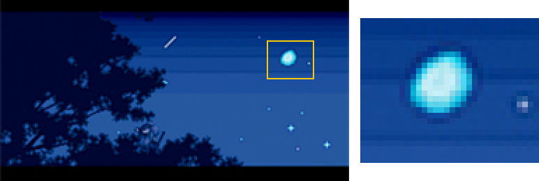
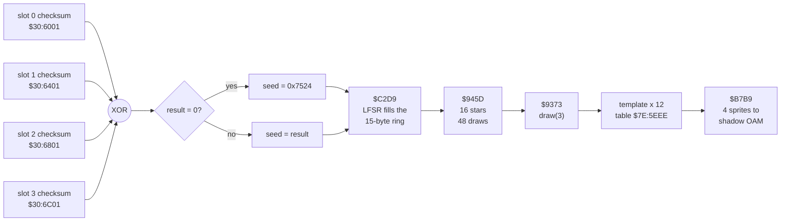

# Which moon do you see at the end of Secret of Mana?

*A plain-language explanation, with the technical details underneath for people who want them.*

## The short answer

The last screen of the game ("The End", the night sky with the tree) shows one of **three moons**: a full moon, a half-lit "gibbous" moon, or a thin crescent.

The game does **not** pick the moon because of anything you did in the story. It rolls a three-sided die, but the roll is not truly random: the result is fixed in advance by a number taken from **your save files**.

So the moon depends on what is stored in your four save slots when the ending starts. It does not depend on which characters you used, which items you found, how long you played, which choices you made, or how fast you pressed the buttons during the credits.

## Everyday version

Imagine the game keeps a notebook for random numbers. Every time the game starts up, it needs a first number to begin writing in the notebook. It does not have a clock to ask, so it looks for something unpredictable lying around. What it finds is the "fingerprint" of your saved games (a small number each save slot stores to prove that its data is intact).

It mixes the fingerprints of the four main save slots into one number, uses that to start its random numbers, and the first few random numbers are spent on drawing the stars in the sky. The next one is "pick moon 1, 2 or 3". Because the start number is always the same for the same saves, the stars and the moon come out the same every time you reach the ending with those saves.

What this means in practice:

- **Same saves, same moon.** Replaying the ending without saving again gives you the same moon every time.
- **Saving can change it.** Saving the game changes the fingerprints, so it almost always changes the starting number, and it usually (about two times out of three) changes the moon. Even if you save twice in the same spot without doing anything, the fingerprint changes: every save advances a save counter stored inside the data. Saving in one slot also rewrites that counter in every other slot that holds a valid save, so their fingerprints change too. (In that do-nothing re-save the changes are small and can occasionally cancel out when several slots are in use, so the moon changes a little less often there, roughly 55 to 67 % of the time depending on how many slots hold saves.)
- **Nothing you did in the story matters.** Beating the final boss in a different way, playing for 10 hours or 40 hours: none of it is read by the moon code.
- **It is fair across all possibilities.** Of all 65,536 possible starting numbers, 22,337 give the full moon, 21,758 the gibbous moon and 21,441 the crescent. Close to a third each.
- **An empty save file gives the gibbous moon.** If the four fingerprints mix to zero (typical of an emulator with no saves), the game uses a built-in fallback number, `0x7524`, and that number happens to give the gibbous moon.

## What the moon is, on screen

The three moons are three small sets of four sprites (little pictures that the console places on top of the background). All three sit in the same place on the screen. Once the scene is built, nothing ever changes the moon again. Only the shooting star passing by and a few blinking stars touch that part of the sky.

The three endings as they look in the game (left: the scene, with the moon boxed in yellow; right: the moon enlarged 8 times):

| Moon | Screenshot |
|---|---|
| T0, full |  |
| T1, gibbous |  |
| T2, crescent |  |

(There is a second thing that looks like moons: two small crescents painted into the daytime clouds of an earlier ending scene. Those are fixed map art and never change.)

## Technical details

All addresses are in the decompressed boot program, which the game copies to work RAM (`$7E:8000` upward) at start-up.

The whole path, from the save RAM to the sprites on screen:



1. **Start-up seeding.** On every start of the boot program, routine `$7E:AD75` reads four 16-bit words from save RAM and combines them:

   `seed = SRAM[$0001] XOR SRAM[$0401] XOR SRAM[$0801] XOR SRAM[$0C01]`

   These are the checksum words of the four primary save slots (the backup slots at `$1000..$1FFF` are not read). If the result is 0, the seed is the constant `0x7524`.

2. **The generator.** `$7E:C2D9` fills a 15-byte ring buffer in `7F:02E5..02F3` from a 16-bit linear-feedback shift register started at that seed. `$7E:C25B` advances the ring and `$7E:C288` returns a value below a limit (power-of-two mask with rejection).

3. **The draws before the moon.** The scene constructor `$7E:945D` builds 16 stars; each star spends draws on its x position, y position and tile. Then `$7E:9373` calls `random(3)` (at `$7E:938B`) and uses the result to index a table at `$7E:5EEE` of three 12-byte entries (four sprites each, three bytes per sprite).

4. **The result is a pure function of the XOR.** Since nothing else feeds the generator before that draw, the moon is `f(XOR of four words)`.

## How it is defined in the original ROM

This section is for people who want to find it in the ROM image. Addresses are 65816 bank:offset; the ROM is the 2 MiB HiROM US image, where `$C7:xxxx` is file offset `0x07xxxx`.

### Where the code and data physically are

The moon code is not stored as plain machine code in the ROM. At power-on the game decompresses a program into work RAM, and that program contains the ending screen. The relevant blocks (`docs/boot.md`, "Measured blocks"):

| What | Stored in ROM at | Decoded to | Notes |
|---|---|---|---|
| Boot / ending program (code and data) | `$C7:7C00` (file `0x077C00`), 14,436 bytes LZ-compressed | `$7E:8000..$7E:D6D2` (22,227 bytes) | Contains every routine below. |
| Configuration tables | `$C7:B480` (file `0x07B480`), 3,389 bytes LZ-compressed | `$7E:5000..` (7,142 bytes) | Contains the three moon templates at `$7E:5EEE` (decoded offset `0xEEE`). |

So there is no readable sequence of bytes at a fixed ROM offset for the routines or the template table: to read them you must run the game's own decompressor (`$C1:4D40`, called with A=`$7EC7`, X=`$7C00`, Y=`$8000` for the first block) or `tools/boot_startup.py` / `tools/boot_decode.py`. Decoded offset = address minus `$7E:8000`: the seed routine `$AD75` is at decoded offset `0x2D75`, the generator `$C2D9` at `0x42D9`, `$C25B` at `0x425B`, `$C288` at `0x4288`, the star constructor `$945D` at `0x145D`, the moon constructor `$9373` at `0x1373` (its draw at `0x138B`).

### The routines, step by step

1. **Seed from SRAM, `$7E:AD75`.** It is called by both entries of the boot program: the power-on entry `$7E:AF0B` and the entry `$7E:AF28` that the ending's software restart jumps to. The call to the generator inside it (`JSR $C2D9`) is at `$7E:ADC1`. The SRAM of the cartridge is mapped at `$30:6000..`. The routine does `LDA $30:6001`, `EOR $30:6401`, `EOR $30:6801`, `EOR $30:6C01`, `TAX`, `JSR $C2D9`. The four slots are 0x400 bytes apart, and the 16-bit word at slot offset 1 is the slot's checksum.

   The save RAM, with what the moon code reads marked (layout from `docs/ui-native-loaded-game-save-validation.md` and the save writer):

   ```
   $30:6000 ┬─ slot 0 ── +0x000        C5  signature
            │            +0x001/+0x002 checksum (16-bit, low byte first)   <── read by $AD75
            │            +0x003..+0x2BA payload, 696 bytes, summed into the checksum
            │                 +0x2B7   save serial of this slot
            │                 +0x2B8   shared save serial (copied to every valid slot)
            │            +0x2BB        3A  signature
   $30:6400 ├─ slot 1    (same layout)                                     <── +0x001 read
   $30:6800 ├─ slot 2    (same layout)                                     <── +0x001 read
   $30:6C00 ├─ slot 3    (same layout)                                     <── +0x001 read
   $30:7000 ├─ backup copies of slots 0-3 ($1000..$1FFF)                   not read
   $30:7FFF ┘
   ```

2. **Fill the ring, `$7E:C2D9`.** A 16-bit shift register `s` starts at X (or at the constant `0x7524` if X is 0). To produce a byte:

   ```c
   do {                                  // step until bit 0 of the new state is set
       t = s & 0x4001;                   // taps: bit 14 and bit 0
       s = (t == 0 || t == 0x4001) ? (s >> 1) : ((s | 0x8000) >> 1);
   } while (!(s & 1));
   byte = (s >> 1) & 0xFF;
   ```

   Fifteen bytes are stored in the ring at `$7F:02E5..$7F:02F3` (cursor at `$7F:02E4`). If the OR of the fifteen bytes is not `0xFF` the whole fill is repeated, continuing from the current `s`; this guarantees the ring is not degenerate.

3. **Advance the ring, `$7E:C25B`.** With `old` the cursor and `new = (old + 1) mod 15`:

   ```c
   ring[new] = (ring[old] - ring[new]) & 0xFF;   // a subtractive lagged generator
   cursor = new;
   return ring[new];
   ```

   Each advance overwrites the next cell with "previous cell minus this cell", walking around the ring:

   ```
     ring:  r0   r1   r2   r3  ...  r13  r14
             │    ▲
             └────┘  1st advance:  r1  := r0  - r1   (returns r1)
                  │    ▲
                  └────┘  2nd:     r2  := r1  - r2   (returns r2)
                                   ...
             ▲                                 │
             └─────────────────────────────────┘  15th: r0 := r14 - r0, then round again
   ```

4. **Draw below a limit, `$7E:C288`.** For a limit `L` (0 means 256; 1 returns 0 without advancing the ring): build the smallest power-of-two mask covering `L-1`, then `repeat { v = advance() & mask } until v < L`.

   For the moon, `L = 3`, so the mask is `0b11` and each advance gives one of four values. A 3 is thrown away and the ring advances again:

   ```
   advance() & 3  ──►  0  → full      (keep)
                       1  → gibbous   (keep)
                       2  → crescent  (keep)
                       3  → reject, advance again
   ```

   The same rejection happens in the stars' `draw(0x68)` (mask `0x7F`, values 104..127 are rejected), so the number of ring advances spent before the moon is 48 or more and depends on the seed. `draw(256)` and `draw(4)` never reject.

5. **Draws in the order the scene spends them.** Before the moon, the constructor `$7E:945D` creates 16 stars. For each star it draws `random(256)` for x, `random(0x68) + 0x38` for y and `random(4) + 0x1C` for the tile (48 draws in total). Then `$7E:9373` calls `random(3)` at `$7E:938B`. In pseudo-code:

   ```c
   seed_ring(sram[0x0001] ^ sram[0x0401] ^ sram[0x0801] ^ sram[0x0C01]);   // AD75
   for (i = 0; i < 16; i++) { draw(256); draw(0x68); draw(4); }             // 945D
   template = draw(3);                                                      // 9373
   ```

   Three worked examples from the model (`tools/ending_moon.py`), one per moon:

   | XOR of the four words | ring after the fill (r0..r14) | advances spent on the stars | moon draw: `advance() & 3` | moon |
   |---|---|---|---|---|
   | `0x0000` (becomes `0x7524`) | `A4 D4 FA 3E 8F C7 E3 71 38 B3 59 AC 15 0A 42` | 53 (5 rejections) | `D9 & 3` = 1 | gibbous |
   | `0x0001` | `FF FF FF FF FF FF FF 7F BF 5F AF 57 AB 55 AA` | 48 | `3F & 3` = 3 rejected, then `78 & 3` = 0 | full |
   | `0x0002` | `00 FF FF FF FF FF FF FF 7F BF 5F AF 57 AB 55` | 49 (1 rejection) | `03 & 3` = 3 rejected, then `36 & 3` = 2 | crescent |

6. **Publish the sprites.** `template * 12` indexes the table at `$7E:5EEE`. Each template is four sprites of three bytes: `y - 0x38`, `x`, and a byte with the tile number in bits 0-5 and the OAM flip bits in bits 6-7. The routine at `$7E:B7B9` writes them to the shadow OAM:

   ```
   T0 (full):     18 C8 1B | 18 D0 5B | 20 C8 9B | 20 D0 DB     tile 27, flips 0/1/2/3
   T1 (gibbous):  18 C8 28 | 18 D0 29 | 20 C8 2A | 20 D0 DB     tiles 40, 41, 42 and tile 27 flipped
   T2 (crescent): 18 D0 2B | 18 D0 2B | 20 C8 2C | 20 D0 2D     tiles 43, 43, 44, 45
   ```

   The full and gibbous templates fill the 2 x 2 grid x = 200/208, y = 80/88. The crescent template places its first two sprites at the same position (x = 208, y = 80) and leaves x = 200, y = 80 empty.

   The same data drawn as the 2 x 2 grid of sprite positions (number = tile, H / V = horizontal / vertical flip from bits 6 and 7 of the third byte):

   ```
                 x = 200      x = 208              x = 200      x = 208              x = 200      x = 208
              ┌──────────┬──────────┐           ┌──────────┬──────────┐           ┌──────────┬──────────┐
     y = 80   │ 27       │ 27  H    │           │ 40       │ 41       │           │ (empty)  │ 43 (x2)  │
              ├──────────┼──────────┤           ├──────────┼──────────┤           ├──────────┼──────────┤
     y = 88   │ 27  V    │ 27  H+V  │           │ 42       │ 27  H+V  │           │ 44       │ 45       │
              └──────────┴──────────┘           └──────────┴──────────┘           └──────────┴──────────┘
                   T0  full                          T1  gibbous                       T2  crescent
   ```

   How each template looks on screen (8x zoom of the screenshots above):

   | T0 full | T1 gibbous | T2 crescent |
   |---|---|---|
   |  |  |  |

   The full moon is one tile mirrored four ways. The gibbous moon reuses that tile for its lower-right quarter and has three tiles of its own. The crescent has no sprite in the upper-left cell.

### Cross-check with the verified C decompilation

Since this page was first written, every routine on the moon path has been decompiled to readable C and verified against the original machine code (differential tests against real emulator captures plus mutation and fuzz checks, `docs/decomp-c-audit-20261019.md`). The C files are the most precise statement of what the ROM does:

| ROM routine | Verified C |
|---|---|
| `$7E:AD75` start-up resources (reads the four SRAM words, loads the config block `$C7:B480` to `$7E:5000`) | [7EAD75_initialize_boot_resources.c](../tools/decomp_c/src/boot/7EAD75_initialize_boot_resources.c): `BUS16(c, 0x306001)`, `0x306401`, `0x306801`, `0x306C01` |
| `$7E:C2D9` seed the fifteen random bytes (X = 0 becomes `0x7524`) | [7EC2D9_seed_fifteen_native_random_bytes_from_saved_slot_counters.c](../tools/decomp_c/src/boot/7EC2D9_seed_fifteen_native_random_bytes_from_saved_slot_counters.c) |
| `$7E:C25B` advance the subtractive ring | [7EC25B_advance_native_fifteen_byte_subtractive_random_ring.c](../tools/decomp_c/src/menu/7EC25B_advance_native_fifteen_byte_subtractive_random_ring.c) |
| `$7E:C288` bounded draw | [7EC288_draw_native_random_byte_below_low_byte_limit.c](../tools/decomp_c/src/boot/7EC288_draw_native_random_byte_below_low_byte_limit.c) |
| `$7E:945D` sixteen stars | [7E945D_construct_sixteen_warm_scene_sprites.c](../tools/decomp_c/src/map/7E945D_construct_sixteen_warm_scene_sprites.c) |
| `$7E:9373` moon: `draw(3)`, then `template * 12` into the table at `$7E:5EEE` | [7E9373_construct_four_warm_scene_template_sprites.c](../tools/decomp_c/src/map/7E9373_construct_four_warm_scene_template_sprites.c) |
| `$7E:B7B9` publish a sprite record | [7EB7B9_publish_native_sprite_record_with_data_bank_7f.c](../tools/decomp_c/src/graphics/7EB7B9_publish_native_sprite_record_with_data_bank_7f.c) |

What the C confirms directly: the four addresses read at start-up are exactly `$30:6001`, `$30:6401`, `$30:6801` and `$30:6C01` (16-bit reads, XORed); the zero case maps to `0x7524`; the moon constructor calls the bounded draw with limit 3 and multiplies the result by 12 (`x*2 + x`, then two shifts) before reading the template bytes from `$7E:5EEE`. This closes the "read from the decoded image, not single-stepped" caveat of the first investigation for these routines. The project's own name for the four words is "saved slot counters"; the save-validation routines (`docs/ui-native-loaded-game-save-validation.md`) show that the word at slot offset 1 is the 16-bit sum of the slot's payload bytes, which is why a changed save usually changes the seed. The save writer (`docs/ui-native-loaded-game-save-write.md`, `tools/ui_native_loaded_game_save_write.py`) adds two details: each save advances a serial counter (values 1 to 99) kept at slot offsets `0x2B7`/`0x2B8`, inside the summed range, and it copies the shared serial at `0x2B8` into every other valid slot and recomputes their checksums. So one save changes the checksum of every valid slot, even when the game state itself is unchanged.

What one save does to the four words the moon reads (example: slots 0, 1 and 3 hold saves, the player saves into slot 1, the serial goes from n to n+1):

```
slot 0  valid   +0x2B8 := n+1                         -> checksum recomputed -> word changes
slot 1  saved   payload rewritten, +0x2B7/+0x2B8 := n+1 -> checksum recomputed -> word changes
slot 2  empty   not touched                                                  -> word unchanged
slot 3  valid   +0x2B8 := n+1                         -> checksum recomputed -> word changes
                                                                                 │
          XOR of the four words changes (almost always) -> new seed -> new stars, usually a new moon
```

### Why the distribution is not exactly one third each

The seed is 16 bits, so there are 65,536 possible starting states (0 is remapped to `0x7524`). Running the model over all of them gives 22,337 full, 21,758 gibbous and 21,441 crescent. The shares differ from an even split by about one percentage point (34.1 %, 33.2 %, 32.7 %); this is a measured result of running the generator, we did not derive the cause analytically.

### Reproducing it

`tools/ending_moon.py` contains a Python model of steps 2 to 5 (`seed_ring`, `Rng.adv`, `Rng.draw`, `predict`) and compares it with the original ROM running in an emulator for any SRAM contents. It stores nothing from the ROM.

## How we know

- We ran the original ROM in an emulator, started the ending event, poked chosen values into the four save words, and read the sprite table from memory: seed 0 gave gibbous; 1, 7 and 0xFFFF gave full; 2 to 6 and 0xBEEF gave crescent.
- A small model of the generator predicted the moon correctly in **300 of 300** random combinations of the four words.
- Changing other bytes of the save (for example a byte inside a slot's data that does not touch the checksum word, or the backup area) did not change the moon.
- Starting the ending with different amounts of idle time and different button patterns did not change the moon for the same save words.
- Watching the moon for 6,000 frames showed that it never changes after the scene is built.

You can reproduce the measurements with `tools/ending_moon.py`. The full write-up, with the code walk-through, is in [ending-moon-20261018.md](ending-moon-20261018.md).

## Honest limits

- The four words are the slot checksums according to the project's verified models of the save validation and save writer routines. The moon code itself only loads those four addresses. We changed those words directly in memory; we did not play through the game's own save routine and watch the moon change.
- A real cartridge with no saves may contain different bytes in its save RAM than the emulator's default fill. The moon is still decided by the same formula, but which moon it is would depend on those bytes.
- Everything here was measured on the North American release, version 1.0: the 2 MiB HiROM image with the header title `Secret of MANA`, usually catalogued as "Secret of Mana (U) [!]" (CRC32 `D0176B24`, SHA-1 `8133041a363e3cc68cedef40b49b6d20d03c505d`, SHA-256 `4c15013131351e694e05f22e38bb1b3e4031dedac77ec75abecebe8520d82d5f`). All addresses in this page refer to that image.
- Whether the title screen reached by the same start-up path draws a moon was not checked.

## One-line summary for sharing

> The moon at the end of Secret of Mana is a three-way die roll, and the roll is seeded by the checksums of your four save slots, so saving the game again will usually change it, but nothing you did in the story does.
